# GlobeTrek Adventures — Authentic Application Screenshots

These screenshots are **unaltered image assets extracted from the submitted CSE5009 — Web Application Development report** (`st20345403_CSE5009_WRIT1.docx`). They document the coursework application at the time of submission; they are **not new runtime screenshots**.

> **Authenticity:** Original embedded PNG bytes are preserved. Every screenshot has its source media filename and SHA-256 checksum in [`SOURCE_PROVENANCE.json`](../evidence/SOURCE_PROVENANCE.json).

## Application gallery

### 1. Home page
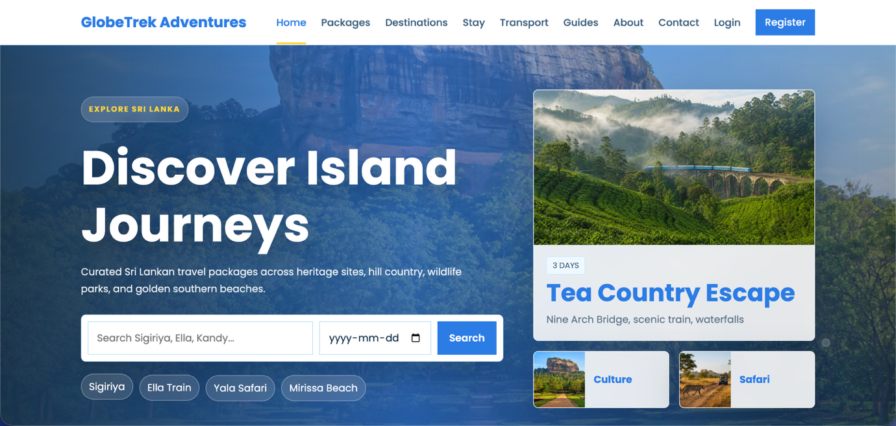
*Report source:* `word/media/image41.png` · Task 02 — implementation, home page.

### 2. Travel package browsing and filters
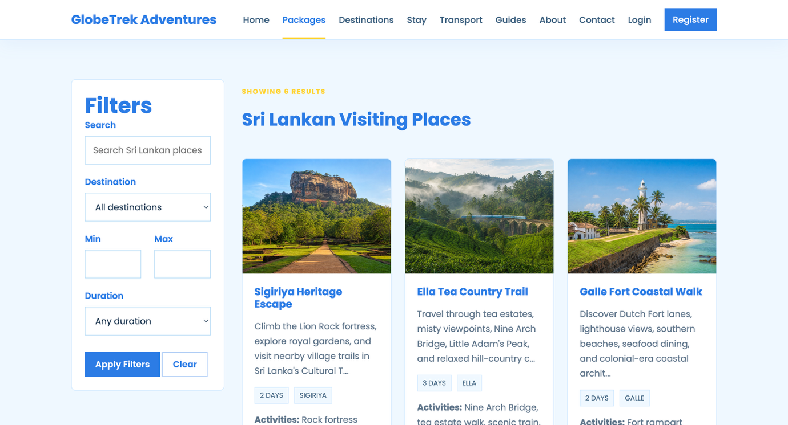
*Report source:* `word/media/image47.png` · Task 02 — implementation, packages.

### 3. Sri Lankan destination cards
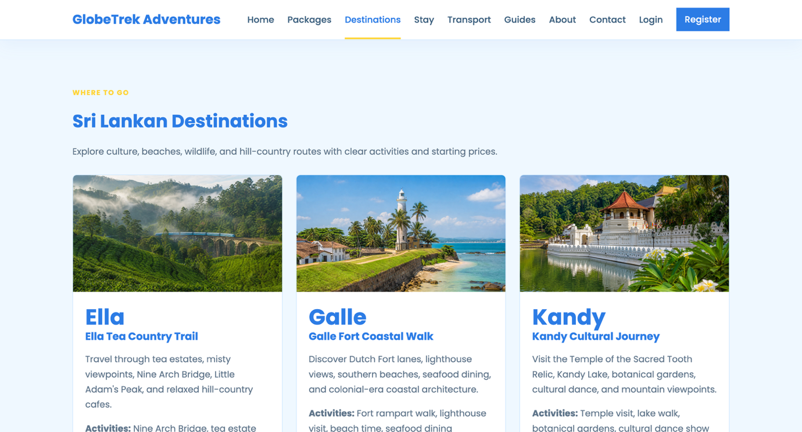
*Report source:* `word/media/image50.png` · Task 02 — implementation, destinations.

### 4. Accommodation listings
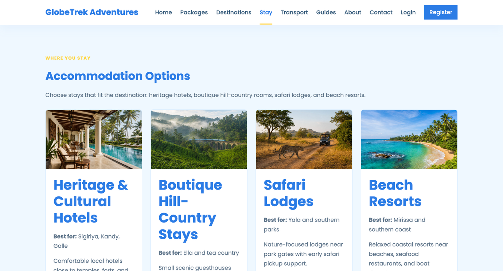
*Report source:* `word/media/image53.png` · Task 02 — implementation, stays.

### 5. Transportation services
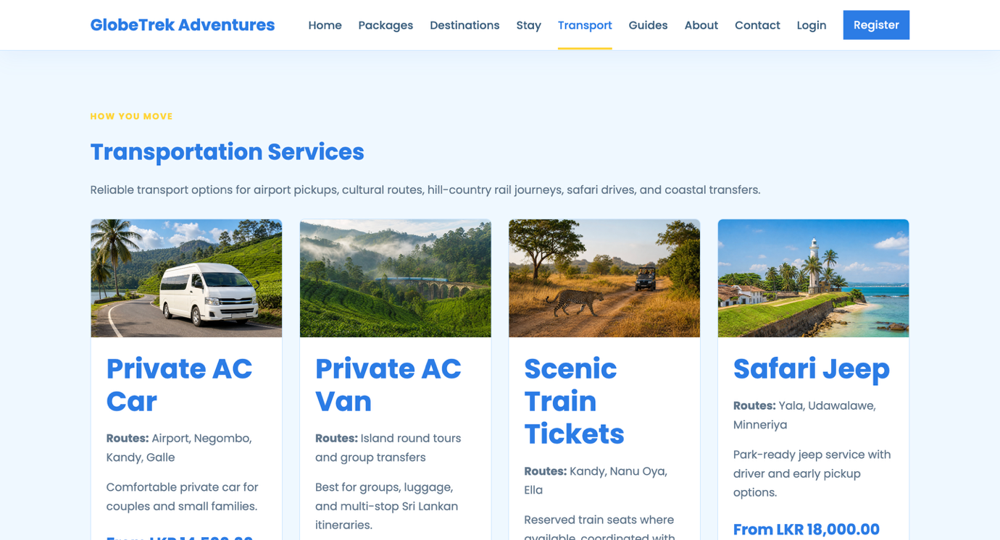
*Report source:* `word/media/image55.png` · Task 02 — implementation, transport.

### 6. Sri Lankan travel guides
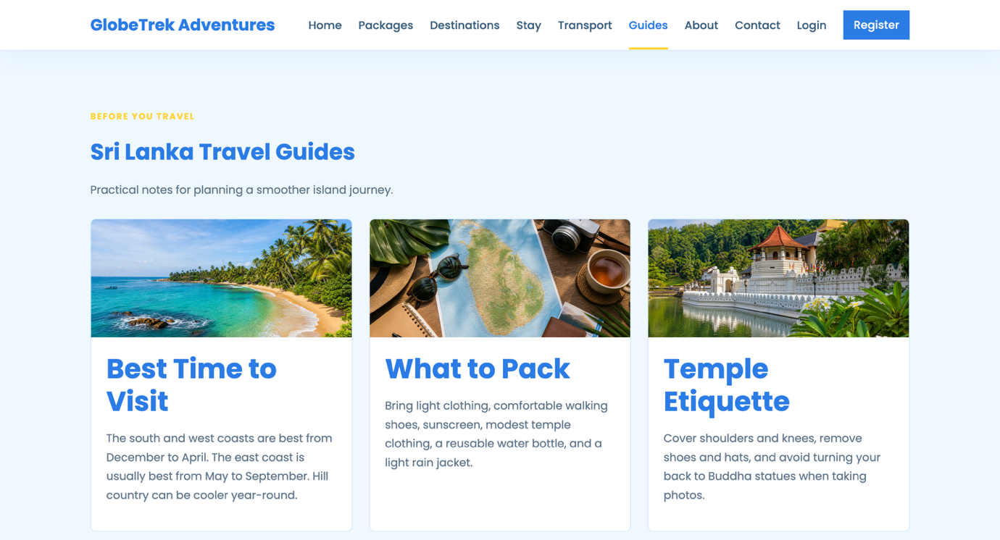
*Report source:* `word/media/image57.png` · Task 02 — implementation, guides.

### 7. Contact and enquiry form
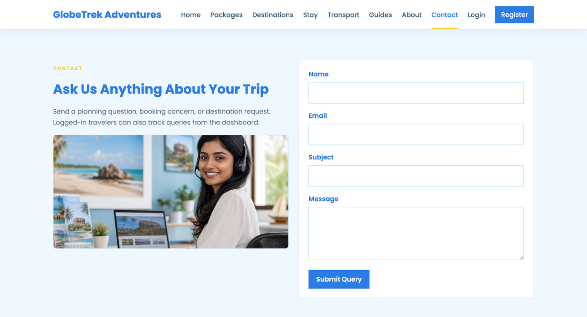
*Report source:* `word/media/image61.png` · Task 02 — implementation, contact.

### 8. User login screen
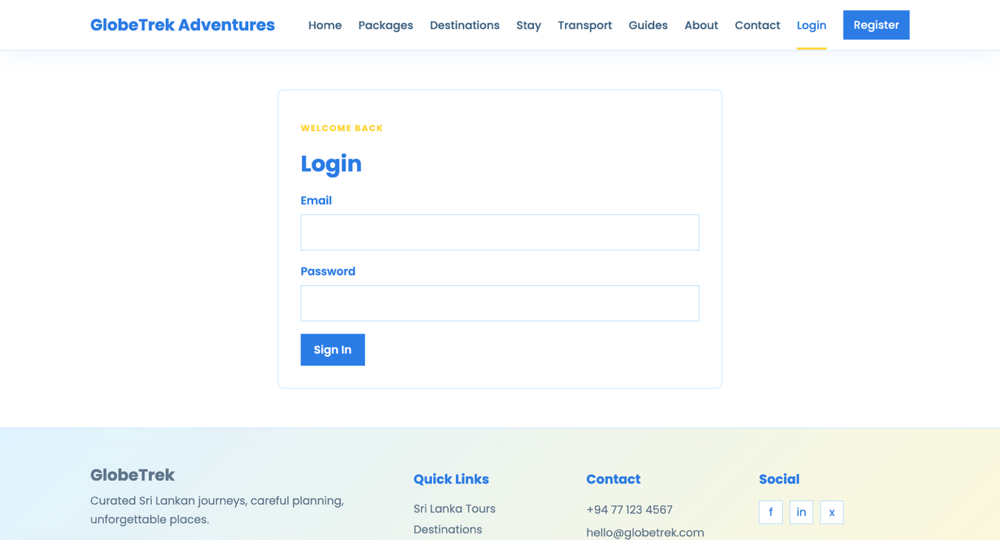
*Report source:* `word/media/image63.png` · Task 02 — implementation, login.

### 9. Customer booking dashboard
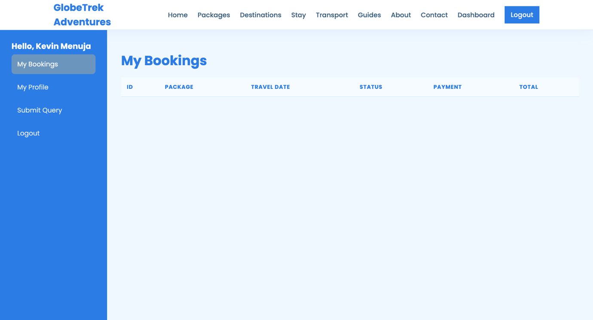
*Report source:* `word/media/image66.png` · Task 02 — implementation, customer dashboard.

### 10. Staff package management dashboard
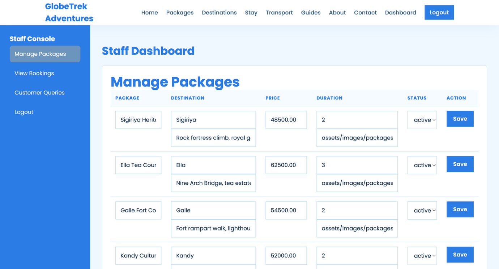
*Report source:* `word/media/image67.png` · Task 02 — implementation, staff dashboard.

### 11. Administrative system dashboard
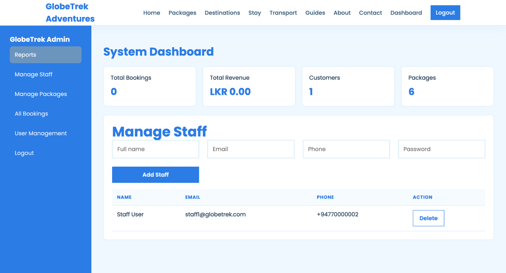
*Report source:* `word/media/image70.png` · Task 02 — implementation, admin dashboard.

## Historical testing evidence

The submitted report documents **15 test cases**. Historical outcomes are summarized in [the report test-evidence summary](../evidence/REPORT_TEST_EVIDENCE.md), with traceability in [`REPORT_TEST_EVIDENCE.md`](../evidence/REPORT_TEST_EVIDENCE.md).

**Important:** Reported test outcomes describe what was documented in the coursework; they do not certify that the current repository was rebuilt, re-run, or independently retested. For any simulated payment flows, no real card transaction or settlement is evidenced.

*The original academic application, database implementation, and workflows have not been altered.*

## Design documentation

[See original planning diagrams from the report](../evidence/DESIGN_EVIDENCE.md). These diagrams are design artifacts, not live app screenshots.
